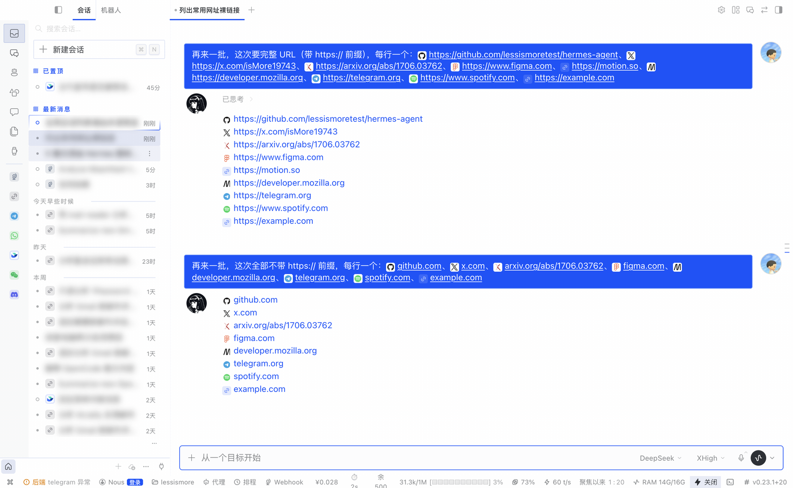

# MyHermes

本仓库是 [NousResearch/hermes-agent](https://github.com/NousResearch/hermes-agent) 的 fork。`myhermes` 分支**只改桌面端 UI/UX**：agent、工具、网关、渠道、模型路由一行没动。

下载、装完、打开，就是下面这个样子——不需要再导入皮肤或插件。



## 跟官方比，改了什么

| 地方 | 官方 | 这里 |
|---|---|---|
| 侧边栏 | 单列会话列表 | **图标栏 + 列表列 + 聊天区**三栏；点图标切「会话 / 定时任务 / 某个渠道」 |
| 渠道 | 混在一个列表里 | 点 Telegram 只留 Telegram 会话，点飞书只留飞书；底部条横跨两列 |
| 新建会话 | 只在顶部工具条 | 搜索框下多一个「新建会话」，带 ⌘N |
| 消息里的网址 | 蓝字 + 外链箭头 | 站点品牌图标（191 个域名内置）+ 品牌原色；未收录域名给通用链条图标 |
| 消息里的路径 | 纯文本 | 灰底小块，点一下在访达里选中/打开 |
| 侧栏分割线 | 1px 硬线 | 2.5% 底色差，跟右侧列表↔聊天之间一致 |

路径识别是**保守**的，只在确定是文件系统路径时才变成小块：

| 会识别 | 不会识别 |
|---|---|
| `~/Downloads/a.png` | `/api/v1/users`（接口路径） |
| `/Users/…`、`/Volumes/…`、`/tmp/…` | 代码块、行内代码里的路径 |
| 带扩展名的绝对路径 | `1/2` 这类分数 |

带空格的路径（`…/Application Support`）目前会断开——路径没有引号时空格就是词边界。宁可漏，不误识别。

## 首次启动做了什么

`apps/desktop/resources/default-profile/` 里放着内置外观（皮肤 `skins/default.yaml` + 两个桌面插件），首次启动时**复制**进 `~/.hermes/`，已有文件不覆盖。所以：

- 想看默认外观 → 直接装
- 想还原 → 删掉 `~/.hermes/skins/default.yaml` 重开
- 这些文件在本机，不会被更新覆盖

## 装

```bash
git clone -b myhermes https://github.com/lessismoretest/hermes-agent.git
cd hermes-agent
bash scripts/build-myhermes.sh
```

脚本会：校验 Node ≥ 26 → `pnpm run pack` → 拷成 `/Applications/MyHermes.app` → 改 bundle id 与显示名 → 删掉官方更新源 → ad-hoc 签名。

要求：macOS、Node ≥ 26、pnpm，且当前在 `myhermes` 分支（脚本会检查）。

**装完要重启 App**：Electron 只在下一次启动加载新的 asar。

## 和上游的差异

改动集中在桌面层，共 17 个文件：

| 文件 | 改了什么 |
|---|---|
| `apps/desktop/src/app/chat/sidebar/index.tsx` | 三栏布局、渠道过滤、新建会话按钮、底部条、分割线、图标栏 i18n |
| `apps/desktop/src/store/layout.ts` | `$railScope`（会话 / 定时任务 / 某渠道）持久化与栏宽 |
| `apps/desktop/src/components/pane-shell/tree/renderer/zone-header-layout.ts` | 侧栏面板 tab 与窗口控件同一行 |
| `apps/desktop/src/lib/session-source.ts` | 会话来源归一化（渠道过滤用） |
| `apps/desktop/src/lib/remarks/file-path-links.ts` | 路径识别、转可点标记、跳过代码与接口路径 |
| `apps/desktop/src/components/chat/file-path-chip.tsx` | 路径小块（点击 `revealPath`） |
| `apps/desktop/src/components/assistant-ui/markdown-text.tsx` | 助手消息接入路径与网址图标 |
| `apps/desktop/src/components/assistant-ui/thread/user-message-text.tsx` | 用户消息接入路径小块 |
| `apps/desktop/src/lib/external-link.tsx` | 网址品牌图标：品牌原色 + 白底；未知域名给链条兜底 |
| `apps/desktop/src/app/messaging/platform-icon.tsx` + `src/assets/feishu.png` | 飞书官方图标（API 图标保持上游的地球） |
| `apps/desktop/electron/default-profile-seed.ts` + `resources/default-profile/` | 首次启动铺外观 |
| `apps/desktop/electron/main.ts`、`electron-builder.config.cjs` | 内置资源打包 |
| `scripts/build-myhermes.sh` | 一条命令构建安装 |

## 跟上游

```bash
git remote add upstream https://github.com/NousResearch/hermes-agent.git   # 只需一次
git fetch upstream
git rebase upstream/main
```

冲突基本只会落在 `sidebar/index.tsx`。上游大改版后，先 rebase 再重新 `bash scripts/build-myhermes.sh`。

## 不含什么

- 不含密钥、账号、`.env`、会话历史、`state.db`、cron 任务、本机路径。
- 不含皮肤里内嵌的个人头像（发布版去掉了头像规则，其余外观一致）。
- 不做第三方插件的兼容承诺：桌面插件与皮肤贴的是宿主内部结构，上游改版后可能要跟着改。

## 许可

上游是 MIT，本 fork 沿用 MIT（见 `LICENSE`）。
